<picture>
  <source media="(prefers-color-scheme: dark)" srcset="cards/hero-dark.svg">
  
</picture>

# Henrique Rezer Mosquér

**PhD student in Computer Science at UFSC · Florianópolis, Brazil**

I research AI for medical imaging, with an interest in reliability, generalization and experimental evaluation. I also develop Python applications that connect machine learning, language models and data to practical workflows.

MSc in Electrical Engineering, with a focus on Biomedical Engineering, at **UFSC** · BSc in Biomedical Engineering at **UFN**.

[GitHub](https://github.com/Henriquerezer) · [LinkedIn](https://www.linkedin.com/in/henrique-rezer-mosquer-39074550/) · [Lattes CV](http://lattes.cnpq.br/0575095096670366) · [Email](mailto:hrezermosquer75@gmail.com)

<a href="#research"><picture><source media="(prefers-color-scheme: dark)" srcset="cards/research-dark.svg"></picture></a>
<a href="#selected-projects"><picture><source media="(prefers-color-scheme: dark)" srcset="cards/engineering-dark.svg"></picture></a>
<a href="#selected-projects"><picture><source media="(prefers-color-scheme: dark)" srcset="cards/data-dark.svg"></picture></a>

## Selected projects

A selection of public prototypes and learning projects. The links expose the implementation and its current limitations; they do not imply production readiness or clinical validation.

| Project | Problem and implementation | Status |
| :--- | :--- | :--- |
| [Gesture-controlled video effect](https://github.com/Henriquerezer/teletransporte) | Connects camera frames from a browser extension to a gesture detector through a WebSocket API. **FastAPI · MediaPipe · JavaScript · Docker.** Modular backend and tests are available in the repository. | Prototype |
| [Local document RAG](https://github.com/Henriquerezer/LLM-BOT) | Extracts PDF text, retrieves relevant passages and returns answers with source-page references. **Python · Ollama · ChromaDB · PyMuPDF.** Includes ingestion and an interactive query script. | In development |
| [Formula 1 ML experiments](https://github.com/Henriquerezer/F1-ML) | Explores historical racing data through SQL features, preprocessing and model tracking. **pandas · scikit-learn · SQLite · MLflow.** Evaluation methodology needs further review; no performance claims are made here. | Experimental |
| [Olist analytics study](https://github.com/Henriquerezer/dashboard/tree/main/Olist_e_comerce) | Examines e-commerce orders, delivery and financial indicators using the public Olist dataset. **Power BI.** Includes a dashboard template and PDF presentation. | Course project |

## Research

My current research interests include chest X-ray analysis, lung segmentation and the evaluation of models for occupational lung disease screening. These are research activities, with no claim of clinical deployment or validation.

**Accepted work — IEEE Healthcom 2026**
*Toward Reliable AI Screening of Asbestos-Related Radiographic Findings in Chest X-rays Using Lung Segmentation.*

Acceptance is author-reported. A published proceedings record and DOI have not yet been independently verified; this entry will be updated when an authoritative bibliographic record is available.

## Tools in my public work

| Area | Examples used in the repositories |
| :--- | :--- |
| ML & experimentation | Python, pandas, NumPy, scikit-learn, MLflow |
| Vision | PyTorch, Transformers / CLIP, TensorFlow / Keras, OpenCV, MediaPipe |
| AI applications | Ollama, ChromaDB, LangChain, Streamlit, PyMuPDF |
| Systems & analytics | FastAPI, WebSockets, JavaScript, Docker, SQL / SQLite, Power BI |

## GitHub activity

Publicly visible calendar activity, shown for context rather than as a measure of technical quality. GitHub may include anonymized private contributions when enabled in profile settings; no private project details are collected.

<picture>
  <source media="(prefers-color-scheme: dark)" srcset="cards/activity-dark.svg">
  
</picture>
<picture>
  <source media="(prefers-color-scheme: dark)" srcset="cards/contributions-dark.svg">
  
</picture>

[Activity data](data/contributions.json) · [How these cards are generated](docs/MAINTENANCE.md)

Em português

Sou doutorando em Ciência da Computação na UFSC, mestre em Engenharia Elétrica pela UFSC e graduado em Engenharia Biomédica pela UFN. Pesquiso IA aplicada a imagens médicas e desenvolvo aplicações com modelos de linguagem, visão computacional e análise de dados. Os projetos acima são exemplos públicos de implementação e aprendizado, com seus estágios de maturidade indicados.

